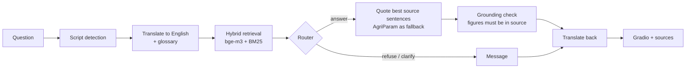

# Farmer Advisory Assistant

Ask crop, irrigation and fertilizer questions in **Tamil, Hindi or English** and get a short
answer in the same language, grounded in agricultural advisory documents, with the source
passages shown beside it. If no source supports an answer, the app says so and suggests
asking a local agriculture officer.

> This is a non-commercial academic prototype. It is **not a substitute for your local
> agriculture officer or Krishi Vigyan Kendra.** Answers can contain translation errors.

## Quick start (one command)

Requirements: Python 3.12, an NVIDIA GPU with 8 GB (CPU works, slowly), about 25 GB disk.

```bash
powershell -ExecutionPolicy Bypass -File run.ps1
```

On Linux/macOS: `bash run.sh`. The script creates `.venv`, installs `requirements.txt`,
downloads the models and the 34 source documents, builds the index
(`scripts/build_data.py`, about 20 minutes the first time) and opens the app at
http://127.0.0.1:7865 (port set in `config.yaml`).

Optional: IndicTrans2 is gated on Hugging Face. To use it instead of NLLB-200, accept its
terms and log in with a token that can read gated repos (`hf auth login`). No other keys
are needed.

## Usage

| Command | What it does |
| --- | --- |
| `python -m src.app.gradio_app` | Web app: chat, language selector, sources panel, thumbs up/down (logged to `logs/feedback.jsonl`) |
| `python -m src.agent.cli "question" [--lang ta\|hi\|en]` | Answer one question in the terminal |
| `python scripts/demo.py` | Six demo questions: answer, clarify and refuse in three languages |
| `python eval/run_eval.py` | Run the 40-case evaluation |
| `python eval/retrieval_eval.py` | Retrieval hit@5 on 15 labelled queries |
| `pytest` | Unit tests (translate, retrieval, router, ingest, config) |

## Architecture



English is the pivot language. Details and design decisions: `docs/ARCHITECTURE.md`.
Models and all settings: `config.yaml`. Model checks: `docs/MODEL_CHECK.md`.

| Layer | Used | Note |
| --- | --- | --- |
| Answer LLM | `bharatgenai/AgriParam` | 2.9 B, bf16, 2048-token window |
| Translation | `facebook/nllb-200-distilled-600M` | fallback; IndicTrans2 is gated |
| Embeddings | `BAAI/bge-m3` | multilingual; also searches the untranslated question |
| Index | ChromaDB + rank_bm25 | reciprocal-rank fusion, top 5 |

## Results (40 cases, `eval/report.md`)

| Metric | Value |
| --- | --- |
| Router accuracy (answer / clarify / refuse) | 0.975 |
| Retrieval hit@5, 15 labelled queries | 15/15 |
| Retrieval hit@5, exact evidence passage, 26 answer cases | 0.46 |
| Groundedness (manual; answers are verbatim source quotes) | 1.00 |
| Answers the question (manual, 26 answer cases) | 0.50 + 3 partial |
| Factual correctness (gold facts present) | 0.22 |
| Domain QA accuracy | 0.525 |
| Back-translation chrF (ta/hi questions) | 54.7 |
| Median latency | 7.5 s |

Answers quote the most relevant source sentences verbatim, with citations, so every figure
shown is exactly as written in the source. AgriParam generates only when no sentence is close
enough, because its paraphrases were often garbled. Out-of-domain questions and pesticide
doses not stated in a source are refused. Tamil translation errors are the main failure cause.

## Limitations

- **Translation errors**, especially Tamil through NLLB: maize became "cornstarch" and zinc
  became "tissue". A crop and unit glossary repairs some of these.
- **Small model, small corpus**: 34 documents; AgriParam paraphrased poorly, so answers are
  quoted source sentences; these can be long or only loosely related to the question.
- **Figures are checked, context is not fully**: a number is shown only if it is in the cited
  source sentence, but that sentence can be about a different crop (see report, f04).
- **Evaluation**: gold facts and the manual check were done by Claude from the sources, not by
  an agronomist; the LLM judge (AgriParam itself) was unreliable.
- **Licences**: most source documents are "all rights reserved"; they are used locally for
  this prototype, and raw files and chunk text are not committed (`data/SOURCES.md`).

## Repository

`src/` code (ingest, translate, retrieval, agent, app) | `data/` sources manifest and
SOURCES.md | `eval/` cases, harness, reports | `docs/` model check and architecture |
`tests/` pytest | `scripts/` downloads, build, demo | `CLAUDE.md`, `TODO.md`, `WORK.md`
project rules and log.
