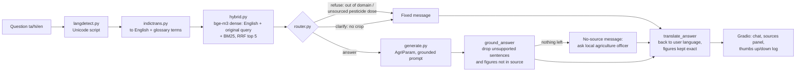

# Architecture

English is the pivot language: questions are translated to English, answered from an English
index, and the answer is translated back. All settings live in `config.yaml`.

## Modules

| Path | Role |
| --- | --- |
| `src/ingest/extract.py` | Text per page (pypdf / trafilatura), script check flags legacy-font pages |
| `src/ingest/translate_docs.py` | Tamil/Hindi pages to English (resumable) |
| `src/ingest/chunk.py` | 300-token chunks (AgriParam tokenizer), 40-token overlap, metadata doc/page/language |
| `src/translate/langdetect.py` | ta / hi / en from Unicode script, no model |
| `src/translate/glossary.py` | Crop and unit terms; figure extraction and checks |
| `src/translate/indictrans.py` | IndicTrans2 if accessible, else NLLB-200; figure-safe answer translation |
| `src/retrieval/embed.py`, `index.py`, `hybrid.py` | bge-m3 embeddings, Chroma index, BM25, reciprocal-rank fusion |
| `src/agent/router.py` | Rule-based `answer` / `clarify` / `refuse` |
| `src/agent/prompts.py` | Grounded prompt (`<context> [n] ... <user> ... <assistant>`), fixed messages |
| `src/agent/generate.py` | AgriParam with a tuple-KV-cache greedy loop; grounding filter |
| `src/agent/pipeline.py` | `Assistant.ask()`: the full chain |
| `src/agent/cli.py`, `src/app/gradio_app.py` | CLI and web UI |
| `eval/` | Cases, metrics, judge, runner, reports |

## Design decisions

- **Context budget.** AgriParam has a 2048-token window, so chunks are capped at 300
  AgriParam tokens: 5 chunks + rules + question fit with 300 tokens left for the answer.
  `build_prompt` drops the lowest-ranked chunk if a prompt still overflows.
- **KV cache.** AgriParam's custom code uses tuple caches that break inside transformers'
  `generate()`. `LLM._greedy_cached` runs greedy decoding with tuple caches (token-identical
  to `generate(use_cache=False)`, verified) and is much faster on long prompts.
- **Quote-first answers.** `extractive_answer` quotes the source sentences most similar to the
  question (bge-m3), only from chunks naming the asked crop, never question-shaped headings.
  AgriParam generates only when no sentence passes the similarity threshold.
- **Grounding is enforced after generation**, not trusted to the model: each sentence must
  overlap a retrieved chunk and every figure in it must appear in that chunk, otherwise it is
  removed. If nothing survives, the no-source message is shown.
- **Figures survive translation.** If an answer sentence loses a number in translation, the
  English sentence is kept beside it.
- **GPU memory (8 GB).** AgriParam (bf16, ~5.9 GB) and NLLB (fp16) stay on the GPU; query
  embedding runs on CPU. Bulk indexing uses the GPU before the LLM is loaded.
- **Second retrieval path.** bge-m3 is multilingual, so the untranslated question is also
  searched; this limits damage from translation errors.
